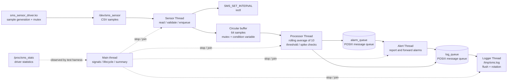

# Embedded Linux Sensor Monitoring System
## Assignment 02 — Technical Design and Evaluation

**Author:** Tong Tran Dang  
**Student ID:** SE204445  
**Course:** Embedded Linux Systems  
**Target:** ARMv7, Linux 5.15.0, QEMU VExpress-A9  
**Document status:** Content draft for review; not a final report or PDF  
**Evidence cutoff:** 2026-11-06

> **Drafting note.** This report uses measured results from the retained logs.
> The Reflection section contains a proposed first-person account based on
> the documented project work and should be reviewed by the author. No claim is made that the
> shutdown-boundary sample-loss behavior has been fixed.

## Abstract

This assignment implements a simulated sensor-monitoring system for an
ARMv7/Linux 5.15 target. A loadable kernel module provides a character device,
CSV-formatted sensor samples, a `/proc` statistics interface, and an ioctl for
changing the sampling interval. A multi-threaded userspace application reads
the device, processes a ten-sample rolling average, reports threshold and
temperature-spike alerts, and writes samples and alerts to a log file.

The application separates acquisition, processing, alert delivery, and logging
into four POSIX threads. A mutex-protected fixed-capacity circular buffer
transfers samples between the sensor and processor threads; POSIX message
queues carry alarm and logging messages. The application is evaluated with
ARM QEMU integration tests, host/mock memory and debugging tools, and
direct-in-thread jitter measurements under two scheduling policies.

The 60-second ARM QEMU integration run processed 119 samples with no circular
buffer overflow. The host/mock Valgrind run completed 35 seconds with no
reported memory errors or leaked bytes. Task 3 profiling is limited to host
x86_64 with a test sensor mock. Direct Sensor Thread jitter measurements
collected 1,000 samples for each policy in ARM QEMU. The measurements show
similar average wake-up lateness for SCHED_FIFO and SCHED_OTHER and frequent
overruns of the requested 10 ms measurement period. QEMU TCG and the guest
kernel timer configuration limit conclusions about real hardware. A controlled
host/mock test also reproduced loss of an in-flight sample at shutdown; a
production fix has not been applied.

## 1. System Overview and Architecture

### 1.1 Scope and environment

The kernel driver generates simulated temperature and humidity values; it is
not connected to a physical sensor. The tested guest is Linux 5.15.0 on ARMv7
using the QEMU VExpress-A9 machine. The Assignment-02 kernel/initramfs were
kept separate from the resources in LAB-02 and Assignment-01. The kernel
configuration enabled POSIX message queues so the userspace application could
use the required IPC mechanism.

Host-side Valgrind, GDB, strace, and perf runs use an x86_64 application and
test-only sensor mocks because the host does not provide `/dev/sms_sensor`.
Those results are identified as host/mock measurements and are not represented
as ARM measurements.

### 1.2 Architecture diagram



The diagram represents the implemented data paths. The main thread configures
the application, starts and joins workers, and owns the final summary. The
driver statistics endpoint is read by the test harness; it is not an
application worker input.

### 1.3 Kernel driver interface

The module registers one character-device number, initializes a `cdev`, creates
the device class and `/dev/sms_sensor`, and creates the read-only
`/proc/sms_stats` entry. Per-open state stores a formatted sample and the
offset within it. This supports partial reads: a sample remains pending until
all bytes in its CSV line have been copied to userspace.

The driver serializes shared interval, sample count, last readings, and timing
state with a kernel mutex. The `SMS_SET_INTERVAL` ioctl copies an unsigned
interval from userspace and rejects zero. `/proc/sms_stats` snapshots the
shared values while holding the same mutex, then formats them through the
seq-file interface. Module initialization unwinds registered resources in
reverse order on failure; module exit removes procfs/device/class/cdev
resources and releases the device number.

The QEMU driver test confirmed module load/unload, character device and proc
entry existence, CSV syntax and range, and interval changes through the ioctl.
For example, the default 60-second integration evidence includes a valid
five-line CSV sample and successful module unload. The report does not infer a
physical sensor's behavior from the simulated source.

### 1.4 Userspace worker responsibilities and design choices

| Component | Responsibility | Main input/output |
|---|---|---|
| Sensor Thread | Configure interval, read and parse CSV, validate values, enqueue samples, optionally record direct wake-up jitter | `/dev/sms_sensor` → circular buffer |
| Processor Thread | Maintain a ten-sample rolling average, detect high-temperature, high-humidity, and temperature-spike events | Circular buffer → alarm and log queues |
| Alert Thread | Receive alarms, print the alert, update counters, forward the event for logging | `alarm_queue` → stderr and `log_queue` |
| Logger Thread | Write sample and alert records, flush periodically, rotate a log larger than 1 MiB, and flush/close on normal shutdown | `log_queue` → `/tmp/sms.log` |
| Main thread | Parse CLI options, initialize resources, block SIGINT for synchronous handling, start/join workers, request stop, print summary | Lifecycle and shared metrics |

A circular buffer is used instead of a linked list because the sample capacity
is fixed at 64. A preallocated ring avoids per-sample allocation and provides
bounded storage with constant-time insertion/removal. When full, it increments
an overflow counter and reports the drop rather than growing without bound.

POSIX message queues separate alert and logging consumers from the processor.
Messages are copied by value and bounded queues provide explicit
backpressure/timeouts. The Logger Thread owns the file stream so other workers
do not block on file I/O or independently manipulate log rotation and flush
state. These choices make the producer/consumer boundaries explicit, but
queue capacity and timeout behavior still require monitoring under heavier
loads than those measured here.

### 1.5 Application state machine

```mermaid
stateDiagram-v2
    [*] --> INIT
    INIT --> RUNNING: context, queues and workers initialized
    INIT --> SHUTDOWN: initialization or worker startup failure
    RUNNING --> SHUTDOWN: SIGINT
    RUNNING --> SHUTDOWN: configured duration expires
    RUNNING --> SHUTDOWN: worker reports fatal error
    SHUTDOWN --> JOINING: stop requested; sensor wake signal sent
    JOINING --> DRAINING: sensor joined; processor exits after buffer close
    DRAINING --> CLEANUP: alert/logger shutdown messages and joins
    CLEANUP --> [*]: queues unlinked, buffer and mutex freed
```



The implemented shutdown ordering requests stop and closes the circular
buffer before joining the Sensor Thread. The processor wakes, consumes any
buffered data, and exits when the closed buffer is empty. The sensor thread is
then joined, followed by processor, alert, and logger workers. Queue unlinking,
buffer destruction, and context cleanup follow the joins. The ordering is
functional for the recorded normal runs but is relevant to the
shutdown-boundary sample-loss finding in Section 3.

## 2. Thread Synchronization and Deadlock Analysis

### 2.1 Shared state and protection

| Shared object/state | Writers/readers | Protection or ownership |
|---|---|---|
| Circular-buffer storage, head, tail, size, totals, overflow count, closed flag | Sensor producer, processor consumer, summary/shutdown code | One `pthread_mutex_t`; `not_empty` condition variable is waited on with that mutex |
| `stop_requested`, failure flag/message, application metrics | Main and worker threads | `state_mutex`; values are copied while locked |
| Alarm and log messages | Producer/consumer workers | Kernel POSIX message queues; fixed-size messages copied by value |
| Sensor configuration | Main initializes; workers read | Immutable after worker startup |
| Processor rolling-window state | Processor Thread only | Thread-local ownership; not shared |
| Logger `FILE *`, file size, rotation state | Logger Thread only | Thread-local ownership; not shared |
| Driver interval and latest sample statistics | Driver read/ioctl/proc handlers | Kernel mutex in the device state |
| Per-open pending CSV line and offset | One open file description | Per-file state and its mutex |

No sample pointer is shared across the circular buffer or queues. Samples and
messages are copied as values. This limits lifetime and ownership ambiguity.

### 2.2 Lock-order / resource-graph reasoning

The application uses two explicit pthread mutexes with distinct roles:
`state_mutex` protects stop/error/metrics state, while the circular-buffer
mutex protects queue indices and sample storage. The code releases
`state_mutex` before calling `circular_buffer_close()`, which then acquires the
buffer mutex; it does not hold both simultaneously. The producer's buffer push
and consumer's buffer pop release the buffer mutex before app metrics updates
or queue operations. Therefore there is no code path in which one thread holds
the state mutex while waiting for the buffer mutex and another holds the buffer
mutex while waiting for the state mutex.

```text
state_mutex  -- never held while acquiring -->  buffer_mutex
buffer_mutex -- released before queue send / metrics update
POSIX queue operations -- no application mutex held
```

`pthread_cond_wait()` atomically releases the circular-buffer mutex while the
processor waits and reacquires it before checking the predicate again. The
consumer uses a `while` predicate loop (`size == 0 && !closed`) to tolerate
wakeups that do not imply an available sample. Queue sends and receives have
timeouts/retry bounds, so a full or empty queue does not create an unbounded
wait while an application mutex is held.

This is a source-based deadlock argument, supported by successful 60-second
integration and shutdown tests; it is not a formal model-checking proof. The
tests demonstrate that the exercised executions completed, not that every
possible schedule is deadlock-free.

### 2.3 Shutdown-boundary race: observed behavior and status

The earlier `-i 200` QEMU run recorded a driver `read_count` delta of 47 while
the application reported 46 processed samples. Three subsequent QEMU trials
matched exactly (46/46, 46/46, and 47/47), so the original QEMU interleaving
was not reproduced. Source inspection identified a plausible shutdown
ordering: `app_request_stop()` closes the buffer before the Sensor Thread is
joined; a sensor read that finishes at that boundary can then be rejected by
`circular_buffer_push()` with `ECANCELED`.

A deterministic test-only host sensor shim was subsequently used to test this
application behavior without editing production source. It delayed a valid
mock sensor read until after the application's one-second stop deadline. The
test log confirms the valid read returned after the stop deadline, while the
application summary reported `processed=0`, `buffered=0`, and `consumed=0`.
This demonstrates that the current shutdown ordering can discard a valid
in-flight sample. It is an application-level shutdown race (the timing of
stop versus a sample completion), not an unsynchronized memory access: the
circular-buffer mutex correctly prevents concurrent corruption.

This test used a host/mock read and does not prove that the original QEMU
`read_count` discrepancy was caused by exactly this interleaving. The driver
increments its counter when generating a sample; the mock has no corresponding
kernel counter. The production code has not been changed and the issue has not
been marked fixed.

A minimal proposed correction is a two-phase normal shutdown: set the stop
flag and wake the Sensor Thread, join the Sensor Thread while the circular
buffer remains open, then close the buffer so the Processor Thread drains any
last successfully enqueued sample before it exits. A regression test should
force an in-flight read across the stop deadline and verify that the returned
sample is enqueued/processed or that the documented shutdown policy explicitly
counts it as discarded. Error-triggered shutdown paths also need review because
`app_fail()` currently closes the buffer immediately. **This proposal requires
author approval before any production-source modification.**

## 3. Measurement Results

### 3.1 Task 1 ARM QEMU integration

| Measurement/check | Observed result |
|---|---:|
| Kernel and architecture | Linux 5.15.0, ARMv7, QEMU VExpress-A9 |
| Device/proc setup | `/dev/sms_sensor` and `/proc/sms_stats` present |
| CSV check | 5 manual lines valid; temperatures 15–45 °C and humidity 30–90% |
| Application duration | 60 seconds |
| App samples processed/buffered/consumed | 119 / 119 / 119 |
| Circular-buffer overflow | 0 |
| Alerts | TEMP_HIGH 20; HUMID_HIGH 20; TEMP_SPIKE 77 |
| Logger output | 236 lines; 23,022 bytes |
| Log rotation | Not triggered; active log remained below 1 MiB |
| Driver counter | 0 before manual CSV check; 5 after manual reads; 124 after app run |
| Queue cleanup and driver unload | PASS |

The application processed 119 samples. The driver counter increased by 124
from zero because the test first performed five manual CSV reads and then the
application performed 119 reads. Thus the counters agree when the manual
pre-test reads are included. The log contained 119 sample entries and 117
alert entries; alert categories can overlap for one sample, so the three alert
counters should not be summed as unique samples.

The full `/tmp/sms.log` file from the guest was not extracted as a standalone
artifact. The retained QEMU transcript records its line count, byte count,
sample/alert counts, and final lines; no missing log contents are reconstructed.

Standalone SIGINT evidence in `logs/sigint_shutdown.txt` records a separate
graceful shutdown test. The default 60-second integration run validates normal
timed shutdown; it is not itself the SIGINT demonstration.

### 3.2 Task 2 memory management and driver integration

#### Valgrind

The host `sms_app_x86` ran for 35 seconds (36 seconds wall time) under
Valgrind 3.26.0 with full leak checking and all leak kinds displayed. Since
the host lacks the sensor character device, a test-only LD_PRELOAD sensor mock
supplied valid CSV data and accepted the interval ioctl.

| Metric | Result |
|---|---:|
| Samples processed | 70 |
| Heap allocations / frees | 18 / 18 |
| Bytes and blocks in use at exit | 0 / 0 |
| Definitely lost | 0 bytes / 0 blocks |
| Indirectly lost | 0 bytes / 0 blocks |
| Possibly lost | 0 bytes / 0 blocks |
| Still reachable | 0 bytes / 0 blocks |
| Memcheck errors | 0 |

This is evidence for the host application path under the supplied mock; it is
not a Valgrind run of the ARM kernel module or target process.

#### ARM QEMU memory footprint

| Time | VmSize | VmRSS | `smaps_rollup` Rss | Pss | Anonymous | Swap |
|---|---:|---:|---:|---:|---:|---:|
| T=5 s | 34,572 kB | 4 kB | 536 kB | 533 kB | 80 kB | 0 kB |
| T=30 s | 34,572 kB | 4 kB | 536 kB | 533 kB | 80 kB | 0 kB |
| T=55 s | 34,572 kB | 4 kB | 536 kB | 533 kB | 80 kB | 0 kB |

The readings were stable over the observed interval. `VmRSS` and `statm`
reported a 4 kB resident value, while `smaps_rollup` reported 536 kB. The
Task-2 analysis attributes this discrepancy to asynchronous per-task RSS
accounting in this Linux 5.15 configuration: `smaps_rollup` walks mapped
pages, while the status/statm counters can lag per-thread accounting. The
report retains both values rather than treating the difference as measured
growth or hiding it.

The captured maps include the application executable's text/data mappings,
heap, four approximately 8 MiB anonymous regions consistent with worker
thread stacks, guard mappings, the main-thread stack, and kernel-provided
vvar/vdso/sigpage mappings. The stack attribution is based on mapping sizes
and the observed five threads; the map file itself does not label those
anonymous regions as pthread stacks.

#### Interval ioctl, read errors, and shutdown accounting

On ARM QEMU, `sms_app -i 200 -d 10 -v` observed 46 application samples with
timestamp gaps from 202 ms to 228 ms and a mean of 217.93 ms. This confirms
the ioctl path changed the driver interval approximately as requested. The
driver counter increased by 47 in that particular run, one more than the
application processed count. Three later runs matched exactly. The evidence
supports a shutdown-boundary explanation but does not establish that it was
the exact cause of the historical mismatch.

Host/mock fault injection exercised one EINTR, one EAGAIN, and one EOF,
followed by valid readings; the app recovered and processed 20 samples. Five
consecutive EOF responses caused a bounded error exit, and strace confirmed
the mock sensor descriptor was closed. These tests cover the application
handling paths, not fault injection into the actual QEMU kernel driver.

**Task 2 assessment:** Valgrind and memory-footprint requirements have
supporting PASS evidence. Driver integration is conservatively **PARTIAL**
because of the retained historical one-sample discrepancy and because
kernel-driver error generation was not fault-injected. The deterministic
shutdown-boundary test in Section 2.3 confirms the app-level sample-loss
possibility but does not retroactively prove the original driver-counter
interleaving or fix it.

### 3.3 Task 3 debugging and profiling

#### GDB

The GDB session ran a debug-symbol host binary with a test sensor mock. It hit
breakpoints at `circular_buffer_pop()` and `circular_buffer_push()`, inspected
the circular-buffer indices and synchronization objects, and captured
backtraces for all five threads. The captured states showed the processor in
the buffer pop path, sensor in the push path, and alert/logger workers in
queue receive paths. Breakpoints were at function entry; this demonstrates
concurrent worker states and the relevant synchronization code, not a proven
mutex-contention event or a demonstrated data-corruption race.

#### strace

The host/mock application ran for 35 seconds with 71 samples processed and no
overflow. `strace -c -w` recorded 1,064 syscalls; the most frequent were:

| Rank | Syscall | Calls | Application role |
|---:|---|---:|---|
| 1 | `rt_sigtimedwait` | 349 | Main thread waits for SIGINT or timeout |
| 2 | `futex` | 275 | pthread mutex/condition synchronization |
| 3 | `mq_timedreceive` | 169 | Alert/logger workers wait for messages |
| 4 | `mq_timedsend` | 73 | Processor/alert workers enqueue events |
| 5 | `clock_nanosleep` | 71 | Sensor sampling period wait |

The largest accumulated syscall time values were `mq_timedreceive` 70.121649
s, `futex` 35.058360 s, `clock_nanosleep` 35.035391 s, and `rt_sigtimedwait`
35.018278 s. `strace -c -w` aggregates time across threads, so its sum can
exceed wall time and is not CPU time. Together with a separate run reporting
0.00 s user CPU, 0.02 s system CPU, and 30.03 s wall time, this indicates a
wait/coordination-dominated host mock workload, not a CPU-bound conclusion
about ARM target execution.

#### perf

`perf record -g -e cpu-clock` captured 96 samples over 35.055 seconds with
zero lost samples. The largest resolved user-space self-overhead entries
included `main` 11.46%, `__syscall_cancel` 8.33%,
`__syscall_cancel_arch_end` 5.21%, `__errno_location@plt` 4.17%,
`clock_gettime` 4.17%, `pthread_mutex_lock` 3.12%, and
`sensor_thread_main` 3.12%. The small sample count and wait-heavy workload do
not establish a computational hotspot. Kernel symbols were unresolved due
restricted kernel address maps; the test sensor shim was part of the profiled
host process.

**Task 3 assessment:** strace and perf have PASS evidence for the requested
host/mock scope. GDB evidence is **PARTIAL**: it captures the worker threads,
shared-buffer entry points, state, and backtraces, but it does not demonstrate
an actual mutex contention event or the shutdown-boundary sample loss. The
separate deterministic host/mock test in Section 2.3 reproduces that
application-level timing race, but it is not the required GDB race-debug
session and no production fix was made. Task 3 results must not be presented
as ARM QEMU profiling.

### 3.4 Task 4 real-time scheduling and direct jitter

The Sensor Thread can request SCHED_FIFO priority 50 and reports the actual
policy. If the request is denied it logs the error and falls back to
SCHED_OTHER priority 0. It uses absolute `CLOCK_MONOTONIC` deadlines and
`clock_nanosleep(..., TIMER_ABSTIME, ...)`. Application startup attempts
`mlockall(MCL_CURRENT | MCL_FUTURE)` and has an unlocked worker-creation
fallback. Jitter instrumentation is opt-in and records the deadline and
immediate post-wake time directly inside the Sensor Thread, before the device
read and sample processing.

#### Measured values

Each QEMU policy run used `-i 10 -d 40`; the Sensor Thread produced 1,000 raw
samples for the jitter calculation. The active policy was confirmed in the
guest: FIFO priority 50 and OTHER priority 0.

| Policy | N | Min | Average | Max | P99 |
|---|---:|---:|---:|---:|---:|
| SCHED_FIFO, priority 50 | 1,000 | 0.419 ms | 5.861 ms | 10.033 ms | 9.883 ms |
| SCHED_OTHER, priority 0 | 1,000 | 0.249 ms | 5.730 ms | 10.571 ms | 10.024 ms |

Histogram counts use the DOCX ranges:

| Jitter bucket | FIFO | OTHER |
|---|---:|---:|
| 0–100 µs | 0 | 0 |
| 100–500 µs | 4 | 5 |
| 500–1,000 µs | 20 | 25 |
| >1 ms | 976 | 970 |
| Early/negative | 0 | 0 |

Text histogram (bar lengths are visual only; counts in parentheses are exact):

```text
SCHED_FIFO   0–100 us (0) | 100–500 us # (4) | 500–1000 us # (20) | >1 ms ################################################## (976)
SCHED_OTHER  0–100 us (0) | 100–500 us # (5) | 500–1000 us # (25) | >1 ms ################################################## (970)
```

The Sensor Thread separately reported 2,742 overdue deadlines skipped across
the full FIFO application run and 2,454 across the full OTHER run. These
full-run counts are not restricted to the first 1,000 raw jitter samples.
The 10 ms requested period was frequently overrun by sensor reads/processing
under this QEMU workload. Expired deadlines are skipped in the measurement
mode and reported separately; otherwise time spent on prior work would be
mistaken for sleep-wakeup lateness. Each recorded jitter was independently
checked as `wakeup_ns - deadline_ns`, and recorded deadline steps were
positive multiples of 10 ms.

The P99 difference is 0.141 ms in favor of FIFO, about 1.4% of the OTHER P99
when computed as `(10.024 - 9.883) / 10.024`. Average jitter was slightly
higher under FIFO (5.861 ms versus 5.730 ms). These single sequential QEMU
runs do not show consistent FIFO improvement. The guest has previously been
measured with 10 ms monotonic-clock resolution, `CONFIG_HZ=100`,
`CONFIG_PREEMPT_NONE=y`, and no `CONFIG_HIGH_RES_TIMERS`; QEMU TCG and host
scheduling further limit interpretation. These results do not establish hard
real-time performance or predict physical ARM behavior.

For a 500 ms industrial sensor cycle, the raw QEMU jitter values are small
relative to the sample period, but the test was run at 10 ms, not at 500 ms,
and does not validate an industrial acceptance threshold. The assignment asks
the student to choose and justify a threshold; this report does not invent a
system requirement. A target-system limit must be specified from the actual
sensor tolerance, control-loop budget, and safety requirements before claiming
acceptability.

### 3.5 Aggregate evidence and reproducibility scope

| Task | Result scope | Evidence-based status |
|---|---|---|
| Task 1 | ARMv7 Linux 5.15 QEMU integration | Core driver/app integration PASS; 60 s, 119 samples, no buffer overflow; standalone SIGINT evidence retained |
| Task 2 | Host Valgrind/mock plus ARM QEMU memory/driver checks | PARTIAL driver integration; memory/leak and host error-path evidence available |
| Task 3 | Host x86_64 with sensor mock | strace/perf PASS; GDB evidence PARTIAL; not ARM profiling |
| Task 4 | ARMv7 Linux 5.15 QEMU | Direct Sensor Thread measurement PASS for 1,000 samples per policy, with timer/virtualization and skipped-deadline limitations |
| Task 5 report | Draft only | PDF not generated; author Reflection requires confirmation |
| Task 5 demo/archive | Not performed | Video and final archive are not present in this draft stage |

## 4. Overall Evaluation and Limitations

The project demonstrates the integration of a Linux character driver with a
multi-threaded userspace application, bounded data structures, kernel/user
interfaces, POSIX IPC, error-path handling, and timed shutdown. ARM QEMU
verified the driver's device/proc interfaces, the application data path,
alerts, logging, queue cleanup, and driver unload. Host tools provided
additional memory and debugging evidence but rely on a sensor mock.

The primary confirmed functional limitation is shutdown-boundary sample loss:
a valid read completing after the stop request can be rejected because the
buffer closes before the sensor worker joins. The deterministic host/mock test
demonstrates the application behavior; the production source is unchanged and
the proposed ordering correction remains unimplemented pending author
approval. The earlier one-sample QEMU driver-counter discrepancy remains
unconfirmed as to its exact interleaving.

Other limits are:

1. QEMU TCG is not physical hardware and does not provide a hard real-time
   guarantee. The guest's timer configuration and host scheduling affected the
   measured timing.
2. The 10 ms jitter experiment frequently skipped expired deadlines. The
   measured sleep-wakeup lateness is separated from that overrun count, but
   the workload cannot sustain the selected test period.
3. Task 3 profiling is host x86_64/mock only. Perf had a sparse 96-sample
   profile and unresolved kernel symbols.
4. The memory status RSS counter differs from the `smaps_rollup` page walk;
   all three timepoints were stable, and the discrepancy is documented.
5. The 60-second QEMU run did not trigger 1 MiB log rotation; rotation is
   covered by unit/runtime tests rather than this integration run.
6. No controlled load sweep, randomized policy order, or physical ARM
   measurement was performed.

Potential future engineering work—subject to a separate review—includes
two-phase shutdown to preserve an in-flight final sample, repeated and
randomized jitter trials, a controlled background-load sweep, and
measurements on the intended ARM target or a PREEMPT_RT configuration. These
are proposals, not completed results.

## 5. Reflection

### 5.1 Most difficult skill

The most challenging technical topic in this project was understanding synchronization and shutdown behavior in a multithreaded application. The Sensor Thread, Processor Thread, Alert Thread, and Logger Thread operate concurrently, so the order in which they stop matters. The test results showed that a valid sensor sample can be lost when a read finishes after the circular buffer has already been closed. Comparing driver read counts with application processing counts also highlighted why measurements from different parts of the system must be interpreted carefully. An important lesson from this work is to separate an observed result from a possible explanation, especially when a timing issue is difficult to reproduce.

### 5.2 What I would design differently

If I redesigned the application, I would improve the shutdown sequence. I would first request the Sensor Thread to stop and wait for it to finish while keeping the circular buffer open. Then I would close the buffer and allow the Processor Thread to process any remaining samples before the alert and logging threads exit. I would also define how the system should handle a sample that arrives during shutdown and add a repeatable test for this situation. This is a proposed improvement; it has not been implemented in the current submission.

### 5.3 Most useful embedded Linux skill in practice

The most useful skill illustrated by this assignment is connecting kernel-space and user-space behavior when debugging an embedded system. The application uses a character device to read data, an ioctl to configure the sampling interval, and POSIX threads and message queues to process and log samples. Tools such as GDB, strace, Valgrind, and perf provide different views of the same system. Understanding how to combine these views would be valuable when developing or testing embedded devices, because a problem observed in the application may originate in the driver, thread synchronization, or the measurement environment.

### 5.4 One future SMS improvement

One improvement I would prioritize is making data logging more reliable across unexpected restarts. The current Logger Thread writes samples and alerts to a file, but a future version could save important records in persistent storage with a clearly defined recovery procedure. I would also test how the logger behaves when storage is full or a write fails. This would make the system more useful for long-running sensor monitoring, where retaining important events matters even if the application or device restarts. This feature is a future proposal, not a completed part of the project.

## 6. References

The following references are those named in the assignment specification.
Edition and bibliographic details should be checked against the exact sources
consulted before final submission.

1. Christopher Hallinan, *Embedded Linux Primer*, 2nd edition, Chapters 8–19.
2. Jonathan Corbet, Alessandro Rubini, and Greg Kroah-Hartman, *Linux Device
   Drivers*, 3rd edition.
3. Michael Kerrisk, *The Linux Programming Interface*, chapters on threads
   and related interfaces.
4. David R. Butenhof, *Programming with POSIX Threads*.
5. Linux man-pages project: `pthread_create(3)`, `mq_open(3)`,
   `clock_nanosleep(2)`, and `sched_setscheduler(2)`.
6. Brendan Gregg, *Systems Performance*, 2nd edition, and perf resources.
7. Linux Foundation PREEMPT_RT documentation.
8. ASSIGNMENT02_EmbeddedLinux.docx, Embedded Linux Systems capstone
   assignment specification.

## 7. Evidence Index

Evidence paths are relative to the project root.

| Report claim | Evidence file(s) |
|---|---|
| Driver, CSV, procfs, 60-second QEMU integration, logs and queue cleanup | `logs/task4_default_mode_qemu.txt` |
| Standalone SIGINT shutdown | `logs/sigint_shutdown.txt` |
| Valgrind output and leak categories | `logs/valgrind_sms.txt` |
| Memory snapshots and mapping/accounting explanation | `logs/task2_rubric_results.txt`, `logs/task2_memory_driver_analysis.txt`, `logs/sms_app_status_t5.txt`, `logs/sms_app_status_t30.txt`, `logs/sms_app_status_t55.txt`, `logs/sms_app_smaps_rollup_t5.txt`, `logs/sms_app_smaps_rollup_t30.txt`, `logs/sms_app_smaps_rollup_t55.txt`, `logs/sms_app_memory_maps.txt` |
| ioctl interval test and historical count discrepancy | `logs/ioctl_interval_test.txt`, `logs/task2_readcount_fault_analysis.txt`, `logs/task2_readcount_repro.txt` |
| Host/mock read-error injection and fd cleanup | `logs/task2_fault_transient.txt`, `logs/task2_fault_eof5.txt`, `logs/task2_fault_eof5_strace_app.txt`, `logs/task2_fault_eof5_strace.txt` |
| GDB worker backtraces | `logs/gdb_sms.txt` |
| strace and syscall analysis | `logs/strace_sms.txt`, `logs/strace_sms_app.txt`, `logs/task3_rubric_results.txt` |
| perf report and raw data | `logs/perf_sms.txt`, `logs/perf_sms.data` |
| Direct Sensor Thread jitter and raw samples | `logs/task4_direct_sensor_qemu.txt`, `logs/jitter_sensor_fifo.csv`, `logs/jitter_sensor_other.csv`, `logs/task4_jitter_analysis.txt`, `logs/task4_rubric_results.txt` |
| Default-mode regression after jitter instrumentation | `logs/task4_default_mode_qemu.txt` |
| Deterministic host/mock shutdown-boundary sample-loss reproduction | `logs/task3_shutdown_race_test.txt`; test-only shim source/binary: `output/qemu-integration/shutdown_race_sensor.c` and `.so` |
| Current project summary | `README.md` |

## 8. Task 5 Rubric and Submission Status

| Rubric item | Current status | Remaining work |
|---|---|---|
| Original architecture diagram | Drafted in this report | Review technical accuracy and render/layout |
| Application state machine | Drafted in this report | Review transition wording against desired shutdown semantics |
| Thread synchronization and deadlock argument | Drafted from current source | Review lock inventory; this is source reasoning, not formal model checking |
| Task 3 GDB race/alert scenario | GDB captures concurrent buffer access and all worker backtraces; it does not reproduce the shutdown race or debug alert-queue delivery | The separate delayed-read test reproduces sample discard but is not a GDB session; report as partial rather than claiming the GDB scenario passed |
| Demonstrate a race discovered and fixed | Race behavior reproduced in host/mock test, but no production fix exists | User requested no further race changes; retain as an unresolved limitation and do not claim “fixed” |
| Measurement results and jitter comparison | Draft includes measured Task 1–4 results and direct Sensor Thread jitter | Verify all evidence paths and final layout |
| Reflection | First-person draft based on documented project work | Author should review the wording before submission |
| Source archive | Prepared as `SE204445_TongTranDang_Asgn02.tar.gz` | Final archive listing check remains |
| PDF, 15–30 pages | Draft PDF prepared | Verify final page count/openability; author should review Reflection before final submission |
| Demo video, 3–5 minutes | Not created, as requested | Record the five DOCX demonstration points if/when requested |

The DOCX lists three separate submission artifacts: source `.tar.gz`, report
PDF, and a 3–5 minute demo video (or a link if the video is too large). The
PDF and source archive are prepared separately; the demo video is intentionally
not created in this request.
